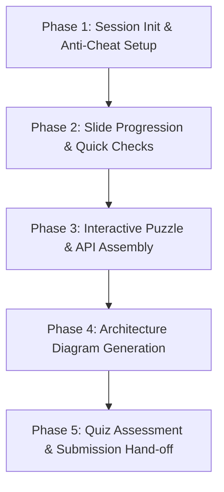

# LessonForge Automation (`lesson-forge-automation`)

A production-grade, authoritative interaction skill designed to empower autonomous browser automation agents (operating via Chrome DevTools MCP, Puppeteer, or Playwright) to navigate, solve, and complete sophisticated, stateful e-learning applications like **LessonForge**.

Interactive LMS platforms use modern web technologies—such as `@dnd-kit` pointer sensors, React Flow interactive node graphs, dynamic form validation, and anti-cheat tab-focus listeners—that commonly cause standard browser agents to stall, fail drag actions, or incur distraction penalties. This skill provides deterministic DOM and React Fiber workflows to complete lessons with 100% accuracy and zero distraction score loss.

---

## When to Use This Skill

- When an AI agent is tasked with taking, reviewing, or automating a LessonForge course or interactive lesson.
- When navigating modern Single Page Application (SPA) e-learning modules featuring inline non-graded checks, slide timers, and graded assessments.
- When an agent encounters drag-and-drop exercises built with `@dnd-kit` where standard mouse drag coordinates fail.
- When an activity requires building or connecting system architecture diagrams in an interactive canvas (e.g. React Flow / `@xyflow/react`).
- When assembling simulated HTTP/REST API event payloads, ordering sequences, or diagnosing broken distributed architectures.
- When executing multi-question quizzes requiring strict state progression and feedback handling.

---

## Architectural Principles & Core Guarantees

1. **Strict Zero-Distraction Protocol**: Modern courseware penalizes tab switching, window blurring, or cursor exits. The agent must operate entirely within the target page context without triggering `blur`, `visibilitychange`, or pointer detachment.
2. **React Fiber State Precision**: When synthetic DOM events (mouse drag, pointer drop) fail against complex UI libraries (`@dnd-kit`, canvas editors), the agent traverses the React Fiber tree (`__reactFiber$`) to trigger state handlers (`onPlacementsChange`, `onDragEnd`) with 100% accuracy.
3. **Graph State Orchestration**: Rather than relying on fragile mouse-coordinate drag connections on canvas SVG handles, agents manipulate node and edge states programmatically via React dispatchers (`setNodes`, `setEdges`) or structured DOM form inputs.
4. **Idempotent Step Gating**: Slides often require passing inline quick checks or waiting for timer countdowns before the "Next" button enables. The agent validates DOM prerequisites before firing navigation.
5. **Rubric-Driven Validation**: For open-ended or diagramming tasks, agents poll the live criteria guidance list (`LIVE GUIDANCE` checklist) to assert all constraints are satisfied prior to submission.

---

## Progressive Disclosure Reference Architecture

To keep the agent's context clean and focused, deep implementation guides and evaluation snippets are organized into modular references:

- [01-platform-topology-and-anti-cheat.md](./references/01-platform-topology-and-anti-cheat.md): UI layout, distraction tracking internals (`visibilityState`, `blur`), "Focus" vs "Casual" mode, and slide lifecycle navigation.
- [02-dnd-kit-and-ordering-interaction.md](./references/02-dnd-kit-and-ordering-interaction.md): Resolving `@dnd-kit` pointer sensor capture failures via keyboard sensor events and React Fiber `onPlacementsChange` injection.
- [03-react-flow-diagram-builder.md](./references/03-react-flow-diagram-builder.md): React Flow architecture, node/edge data structures, programmatic dispatch, and live rubric verification for diagram activities.
- [04-assessment-and-api-builder.md](./references/04-assessment-and-api-builder.md): Solving REST API event builders, diagnostic case studies, and automated multi-question quiz loops.

---

## Bundled Helper Tools & Scripts

- **LessonForge DOM Evaluation Helpers**:
  ```javascript
  // Available in scripts/lessonforge-eval-helpers.js
  // Can be embedded directly into evaluate_script calls
  ```
- **Skill Specification Compliance Validator**:
  ```bash
  node scripts/validate-lesson-skill.js .
  ```

---

## Procedural Workflow (5 Phases)



### Phase 1: Session Intake & Distraction Guard
1. Navigate to lesson URL using Chrome DevTools MCP `navigate_page`.
2. Inspect the entry modal: Select **Casual mode** or **Focus mode** (Casual mode is recommended for headless browser automation to avoid fullscreen OS prompts).
3. Verify that the initial `Distractions: 0` counter is rendered in the top status bar.
4. Keep the automation strictly inside the active page session; never invoke `new_page` or external navigations that trigger `window.onblur`.

### Phase 2: Slide Progression & Non-Graded Quick Checks
1. Read slide content and check for inline interactive elements (`QUICK CHECK`, `Peek Analogy`, or accordion drawers).
2. If a `QUICK CHECK` is present, select the correct option button immediately.
3. Observe feedback ("Nailed it!"). Confirm that the bottom navigation button (`Next`) becomes enabled (`disabled` attribute removed).
4. Click `Next` and poll `take_snapshot` until the slide counter increments (`n / total`).

### Phase 3: Interactive Puzzles & API Payload Assembly
1. **Matching & Reordering**: For cards or chips requiring slot assignment, test accessibility buttons or invoke `scripts/lessonforge-eval-helpers.js` to dispatch placements directly to the `@dnd-kit` container.
2. **REST API Event Assembler**: Select HTTP method (e.g. `POST`), path (`/rfid`), headers (`application/json`), and body payload. Click `Send Request` and verify HTTP 200/201 response.
3. Verify completion checkmark before proceeding.

### Phase 4: Architecture Diagram Generation
1. Identify required components from the slide instructions (e.g. Client, Service, Database, External Service).
2. Locate the React Flow canvas container and its parent React Fiber.
3. Either:
   - Use the element creation toolbar and property inputs (`input[aria-label="Element name"]`), or
   - Dispatch the required nodes and edges directly into the component's state hook via `setNodes` and `setEdges`.
4. Inspect the `LIVE GUIDANCE` checklist elements to ensure all rubric points show green checkmarks (100% score).
5. Click `Submit diagram`.

### Phase 5: Comprehensive Assessment & Submission Hand-off
1. On assessment slides (e.g. 20-question final check), read each question and available options.
2. Click the matching answer button, then click `Check Answer`.
3. Wait for feedback confirmation, then click `Next Question`. Repeat until all questions are completed.
4. On reaching the **Lesson Complete!** screen, verify final scores and distraction count (0).
5. If a `returnUrl` parameter was present, click the return button to hand off completion state to the student portal.

