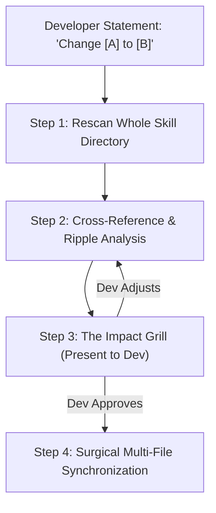

# Fluidity & Consistency Ripple Protocol

This reference governs how the `system-spec-generator` agent handles modifications, pivots, and evolutions in an existing generated system specification.

---

## 1. The Fluidity Principle

A generated functional specification is **never a static, one-time artifact**. Systems evolve as developers build, test, and refine ideas. 

Examples of developer changes:
- *"I dislike using mysqli, switch to PDO with prepared statements."*
- *"I want a different guest data structure containing deviceId and pushToken."*
- *"Add a new route DELETE /api/queue/tickets/:id for cancelling tickets."*
- *"Students should not be allowed to access financial category tickets."*

Instead of regenerating the entire skill from scratch (which wipes out hard-won context), the agent performs a **Consistency & Ripple Analysis Pass** to surgically synchronize all affected specifications.

---

## 2. Triggering the Update Protocol

The update protocol is activated whenever:
1. The developer states a requirement change or architectural modification.
2. The developer explicitly commands `/grill-me`, *"update the spec"*, or *"re-image the functional skill"*.
3. A coding agent detects that code implementation requires a spec adjustment.

---

## 3. The 4-Step Consistency & Ripple Analysis Pass



### Step 1: Rescan the Whole Skill Directory
Read all files under `.agents/skills/<project>-system-spec/references/`:
- `topology.md`
- `routes.md`
- `roles.md`
- `flows.md`
- `data-models.md`
- `stack-rules.md` (or `architecture/*`)

### Step 2: Cross-Reference & Ripple Analysis
Identify every location where the change introduces dependencies or inconsistencies:
1. **Direct Changes**: The exact field, driver, route, or role being modified.
2. **Cascading Route Changes**: Endpoints whose input bodies, response shapes, or path parameters depend on the changed item.
3. **Cascading Flow & State Changes**: Business logic steps, state transitions, or database transaction calls that rely on the old behavior.
4. **Cascading Role/Permission Changes**: Actors whose access boundaries are impacted.
5. **Inconsistency Detection**: Any contradictory rules created by the modification (e.g., a route expecting a field deleted from `data-models.md`).

### Step 3: The Impact Grill (Developer Review)
Present a complete, detailed impact breakdown to the developer. Always follow this structured format:

```markdown
### 🔍 Proposed Change Impact Analysis

**Change Request**: Update [Target Component] from `[Original State]` to `[New State]`

#### 1. Direct Modifications
- `references/<file>.md`: [Exact lines or section to be modified]

#### 2. Cascading System Ripples
- `references/routes.md`: Endpoint `POST /path` request body must now require `[field]`.
- `references/flows.md`: Step 2 in `[Flow Name]` must handle `[new state transition]`.
- `references/roles.md`: Role `[Actor]` access updated to `[Allowed/Denied]`.

#### 3. Inconsistency & Conflict Warnings
- ⚠️ Warning: Route `GET /path/:id` currently returns the legacy structure without `[field]`.

#### 4. Architectural Suggestions
- 💡 Recommendation: Update the shared response envelope in `data-models.md` to keep API responses uniform across both web and mobile.

> **Confirmation Required**: Do you want to apply these synchronized updates across all specification files?
```

### Step 4: Surgical Synchronization
Once the developer confirms:
1. Update each affected file cleanly using localized edits.
2. Update the router table in `SKILL.md` if routes, roles, or flows were added or removed.
3. Run the validation script (`node scripts/validate-system-skill.js`) to guarantee frontmatter and markdown links remain 100% healthy.
